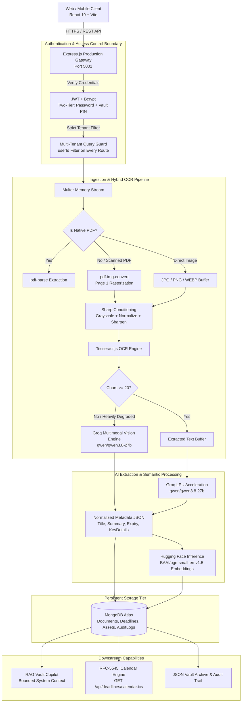

# DocVault: Privacy-First Intelligent Personal Document Vault & RAG Copilot

[](https://github.com/AkshatMishra29/DocVault-New)
[](https://groq.com/)
[](https://tesseract.projectnaptha.com/)
[](https://jwt.io/)

---

## 1. Executive Summary & Problem Statement

### 1.1 The Core Problem
Modern households, freelancers, and professionals handle dozens of mission-critical documents annually—health & motor insurance policies, passport/ID proofs, home deeds, appliance invoices, and warranty certificates. Users face three major pain points:
1. **Dispersed, Unsearchable Formats**: Documents arrive as physical paper scans, photos taken on mobile cameras (often blurry or tilted), and digital PDFs with flattened, non-selectable text layers. Traditional cloud drives (Google Drive, Dropbox) treat them as static binary blobs without parsing their internal semantics.
2. **Expired Policies & Missed Deadlines**: Lapsed vehicle insurance results in legal penalties; expired medical coverage or missing warranty dates cause direct financial loss. Manual calendar entry is tedious and rarely maintained.
3. **Privacy Concerns & Commercial AI Leakage**: Uploading unredacted contracts, government IDs, and financial portfolios to public commercial chatbots risks cross-tenant exposure and model training on private customer data.

### 1.2 The DocVault Solution
DocVault is an **air-tight, privacy-first personal document custodian** and **interactive AI copilot**. It autonomously:
- Ingests native PDFs, scanned non-selectable PDFs, and image snapshots (JPG, PNG, WEBP, BMP, TIFF).
- Executes a multi-tier **Hybrid OCR & Image Conditioning Pipeline** that cleans images and transcribes text locally before falling back to high-throughput multimodal vision models.
- Extracts structured entity metadata (Policy numbers, sums insured, coverage types, vehicle details, expiration dates) using Groq-accelerated inference.
- Provides a **strictly bounded conversational RAG copilot** that answers queries exclusively using the authenticated user's vault documents, preventing hallucinations and external data leakage.
- Enforces **zero-trust multi-tenancy** secured by dual-layer authentication (Password + Personal Vault PIN).

---

## 2. System Architecture & High-Level Topology



---

## 3. Technology Stack Breakdown

| Layer | Technology | Version | Purpose & Architectural Justification |
|---|---|---|---|
| **Frontend Framework** | React | `^19.3.1` | Single-Page Application (SPA) client leveraging modern hooks and component life-cycles |
| **Bundler & Tooling** | Vite | `^8.3.5` | Lightning-fast HMR and optimized production treeshaking |
| **Routing** | React Router DOM | `^7.18.4` | Declarative client-side routing, protected routes, and URL query parameter filtering |
| **Icons & UI Kit** | Lucide React | `^1.62.0` | Crisp, scalable SVG iconography |
| **Markdown Parser** | `react-markdown` + `remark-gfm` | `^10.1.0` / `^4.0.1` | Formatted AI chat responses with tables, headings, code, and lists |
| **Backend Runtime** | Node.js (ES Modules) | `>=20.0` | Non-blocking asynchronous I/O optimized for file streams and API orchestration |
| **HTTP Framework** | Express.js | `^5.3.0` | Robust REST API endpoints with middleware chains |
| **Database & ODM** | MongoDB Atlas + Mongoose | `^9.11.4` | Flexible schema handling dynamic document metadata and unstructured key-value fields |
| **Image Preprocessing** | Sharp | `^0.34.0` | C-libvips-backed image conditioning (grayscale, normalization, sharpening) for OCR accuracy |
| **Digital PDF Parsing** | `pdf-parse` | `^2.4.5` | Rapid text layer extraction for digitally created PDFs |
| **Scanned PDF Rendering**| `pdf-img-convert` | `^2.0.0` | Converts scanned PDF pages to high-resolution PNG buffers |
| **Local OCR** | `tesseract.js` | `^7.0.0` | Pure JavaScript/WebAssembly optical character recognition |
| **Multimodal Vision & LLM**| Groq SDK (`qwen/qwen3.8-27b`) | `^1.6.0` | Ultra-low latency LPU inference for visual extraction, entity parsing, and RAG chat |
| **Embeddings** | Hugging Face Inference API | `BAAI/bge-small-en-v1.5` | 384-dimensional vector embeddings for document semantic indexing |
| **Cryptography & Auth** | `bcryptjs` + `jsonwebtoken` | `^3.0.3` / `^9.0.3` | Salted password & PIN hashing (10 rounds) and scoped JWT tokens |

---

## 4. Key Features & Workflows

### 4.1 Dual-Tier Authentication & Hardware Keypad Unlock
- **Step 1 (Credential Gate)**: Email and password authentication yields a temporary 15-minute PIN unlock token.
- **Step 2 (Vault PIN Gate)**: User verifies a 4-to-6 digit numeric PIN to unlock full session access (`7d` token).
- **Desktop & Mobile Ergonomics**: The PIN screen provides both a touch-optimized on-screen keypad and **full physical keyboard + PC Numpad listener (`Numpad0` - `Numpad9`, `Backspace`, `Enter`, `Escape`)**.

### 4.2 Multi-Tier Hybrid OCR Pipeline
Documents uploaded in varying conditions pass through an adaptive extraction hierarchy:
1. **Tier 1 (Digital PDF Parser)**: Rapidly extracts selectable text via `pdf-parse`. If text length exceeds 30 characters, OCR is bypassed for maximum speed.
2. **Tier 2 (Scanned PDF Rasterizer)**: If a PDF contains no selectable text, `pdf-img-convert` renders page 1 into a crisp image buffer.
3. **Tier 3 (Sharp Conditioning + Tesseract.js)**: All image buffers (uploaded JPG/PNG or rasterized PDF pages) are conditioned through `sharp` (grayscaling, contrast stretching, sharpening) and parsed locally with `tesseract.js`.
4. **Tier 4 (Multimodal Vision Fallback)**: If local OCR yields fewer than 20 characters (blurry photo, cursive receipt, tilted phone capture), the raw buffer is passed to **`qwen/qwen3.8-27b`** via Groq's Vision API, returning structured transcription and entity fields in strict JSON.

### 4.3 Automated Entity & Expiration Extraction
Every uploaded document is automatically analyzed to populate:
- **Core Classification**: Assigned to one of 6 standardized categories (`Insurance`, `Identity`, `Medical`, `Property`, `Appliances`, `Other`).
- **Entity Map (`keyDetails`)**: Dynamic key-value pairs (e.g., `Policy Number`, `Sum Insured`, `Registration No.`, `Serial Code`). Keys are sanitized to prevent MongoDB Map casting exceptions.
- **Automated Deadline Creation**: Any detected expiry or renewal date automatically creates a tracked record in the user's `deadlines` collection.

### 4.4 Air-Tight Bounded RAG Chatbot
- Integrated in the **Ask AI** tab (`/ask-ai`).
- Accepts natural language inquiries regarding coverage limits, claim steps, warranty expiration, and policy clauses.
- **Strict Bounded Context**: System instructions explicitly forbid the AI from pulling external world knowledge or fabricating clauses. Responses must cite verified document names and categories.
- **Rich Markdown Formatting**: Responses render cleanly with headings, tables, bullet points, and code formatting via `react-markdown` and `remark-gfm`.

### 4.5 Calendar Synchronization (.ICS Export)
- Route: `GET /api/deadlines/calendar.ics`
- Aggregates all pending renewal and expiration deadlines for the authenticated user and converts them on-the-fly into standard RFC-5545 iCalendar (`.ics`) format.
- Allows one-click subscription and import directly into **Google Calendar, Apple iCalendar, or Microsoft Outlook**.

### 4.6 Tamper-Proof Audit Trail & Portable Vault Export
- **Audit Logging**: Tracks security and access events (`VIEW`, `DOWNLOAD`, `UPLOAD`, `DELETE`, `LOGIN`) tied to specific users.
- **Full Vault Archive (`GET /api/vault/export`)**: Allows users to export their entire document registry, linked household assets, and deadline schedules as an offline-readable, portable JSON archive.

---

## 5. Security & Isolation Architecture

1. **Strict Multi-Tenant Isolation**: Every database interaction (`find`, `findOne`, `create`, `delete`) binds strictly to `req.user.userId`. There are zero global or shared lookups.
2. **Sanitized Document Storage**: File binary data is stored safely in MongoDB base64 buffers or isolated Firebase storage references without exposing direct public URLs.
3. **Zero Data Leakage to AI**: AI prompts are constructed dynamically per user request. Context windows include only documents belonging to that authenticated tenant ID.
4. **CORS Hardening**: Access is restricted to designated production domains (`onrender.com`) and whitelisted local development environments.
5. **No Dangerous String Keys**: Document metadata properties undergo character replacement (`.` and `$` replaced by `_`) to eliminate NoSQL injection risks in dynamic object fields.

---

## 6. API Reference (Core Endpoints)

### Auth Endpoints
* `POST /api/auth/register` — Create new vault account with hashed credentials and PIN.
* `POST /api/auth/login` — Step 1 authentication; returns session requiring PIN.
* `POST /api/auth/verify-pin` — Step 2 authentication; verifies PIN and issues full JWT.

### Document & Asset Endpoints
* `GET /api/documents` — List user's documents (supports category and query filtering).
* `POST /api/documents/upload` — Multipart upload; triggers OCR pipeline, Groq extraction, and HF embeddings.
* `GET /api/documents/:id` — Retrieve detailed document metadata and verification records.
* `DELETE /api/documents/:id` — Remove document and purge associated binary references.
* `GET /api/assets` & `POST /api/assets` — Manage tracked household and vehicle assets.

### Deadlines & Calendar Endpoints
* `GET /api/deadlines` — List upcoming renewal dates and linked policies.
* `GET /api/deadlines/calendar.ics` — Export all vault deadlines to standard iCalendar format.

### AI & Export Endpoints
* `POST /api/ai/query` — RAG query engine across vault documents or focused on a single file.
* `GET /api/vault/export` — Download full encrypted vault metadata snapshot.
* `GET /api/vault/audit-trail` — Fetch security log entries for the account.

---

## 7. Roadmap & Recommendations for Production Polish

To elevate DocVault from a functional release to a high-scale commercial standard:

1. **True Vector Similarity Search in MongoDB**:
   - Currently, embeddings are generated and stored via Hugging Face (`BAAI/bge-small-en-v1.5`).
   - Implement **MongoDB Atlas Vector Search** (using an HNSW index) to perform true cosine similarity search rather than relying on recent document retrieval.
2. **Client-Side AES-256 File Encryption**:
   - Encrypt files in the browser using the user's Vault PIN as a key derivation seed (PBKDF2/Argon2) before transmitting to the server. This ensures **zero-knowledge storage**, where even server administrators cannot view raw documents.
3. **Multi-Page OCR & PDF Splitting**:
   - Expand `pdf-img-convert` to process multi-page documents asynchronously in background workers, aggregating text across all pages.
4. **Automated WhatsApp / Email Reminder Webhooks**:
   - Integrate Twilio or SendGrid cron workers that evaluate `deadlines` nightly and dispatch renewal reminders 30, 15, and 3 days before expiration.
5. **Rate Limiting & Brute-Force Throttling**:
   - Add `express-rate-limit` on `/api/auth/verify-pin` (e.g., maximum 5 attempts per 15 minutes) to protect against PIN brute-forcing.

---

## 8. Local Setup & Execution Guide

### Prerequisites
- Node.js `>= 20.0.0`
- MongoDB instance (Atlas cluster or local MongoDB daemon)
- Groq Cloud API Key (`gsk_...`)
- Hugging Face Access Token (`hf_...`)

### 1. Backend Setup
```bash
cd backend
npm install
# Ensure .env is populated with MONGODB_URI, GROQ_API_KEY, HUGGINGFACE_API_KEY, JWT_SECRET
npm run dev
# Server initiates on http://localhost:5001
```

### 2. Frontend Setup
```bash
cd frontend
npm install
npm run dev
# Client initiates on http://localhost:5173
```
